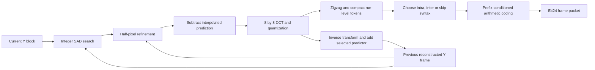

# Luminance codec and instructor benchmark

## Running a new sequence
From the FP folder in PowerShell, supply the actual width and height of a tightly packed 8-bit Y file. Rows are stored consecutively, with no header or chroma planes. The encoder checks that the file contains whole frames, reads only the requested prefix and stores the dimensions in the compressed header. The decoder needs only the E424 file. It crops internal edge padding back to the supplied dimensions.

```powershell
$py = '.\.venv\Scripts\python.exe'
$inputY = 'C:\Users\gam\Courses\ENSC424\lab6_Matlab\Matlab\foreman_qcif.y'
& $py -m en424 encode $inputY output/foreman.e424 --width 176 --height 144 --frames 100 --quality 50
& $py -m en424 decode output/foreman.e424 output/reconstructed.y
& $py -m experiments.foreman_reference $inputY output/instructor_comparison
```

For another sequence, replace the input and dimensions. Omit --frames to process the whole file, subject to available memory and the decoder's default 100-million-padded-sample limit. Decode to a directory for numbered PNGs. A wrong dimension pair can still produce a divisible byte count, so obtain dimensions from the sequence provider. For any raw Y input, `evaluate` accepts the same width/height and sweeps the requested --qsteps for intra and hybrid. The instructor comparison command specifically uses QCIF Foreman frames 0–99, with no resizing or temporal subsampling.

## Quantization and prediction
The encoder accepts either --quality (1–100) or --qstep (1–255). Higher quality means a finer transform quantizer. Project qualities 10, 30, 50, 70 and 90 use steps 65, 42, 29, 21 and 10 respectively. The same step applies to all frames. The two codecs have different quantizers, so compare rates at matched PSNR. The instructor's quality labels identify the supplied reference measurements.

Raw Y automatically selects E424 version 2. By default the first frame is an I-frame and the remaining frames are P-frames. Every P-frame predicts from the preceding reconstructed frame. Individual P blocks can select intra fallback or skip. Explicit --gop enables periodic refresh. Legacy version 1 and existing color input workflows are supported. FPS defaults to 30 for raw input and can be overridden. The reported bpp and PSNR are independent of FPS.



## Version 2 bitstream changes
The container keeps the version-1 header and packet layout. Version 2 permits GOP zero, meaning initial I-frame only. Motion components are signed half-pixel offsets. The encoder first finds the best integer SAD match, then searches its in-bounds half-pixel neighborhood. Horizontal and vertical half samples average two adjacent samples. Diagonal half samples average four. Both implementations use the same unrounded floating-point predictor before adding the inverse-transformed residual and rounding the output pixels.

Every transform block begins with its nonzero count. For zero runs 0–7 and magnitudes 1–7, one token encodes both values: 1 + 14 × run + 2 × (magnitude − 1) + negative-sign flag. Token zero escapes to the original run and signed-level integers. For each syntax byte the arithmetic model begins at context 1 and follows a binary tree of previously observed bits in that byte. Counts reset per frame. The decoder selects these rules from the version byte; side information travels in the E424 stream.

## Comparison method
The reference rates and PSNRs are transcribed from the instructor's message. For each tested quantizer the runner saves one stream, reads it back, decodes it independently and checks every pixel against the encoder reconstruction. It checks the frame-type sequence as well. Rate is 8 × complete saved file bytes / (100 × 176 × 144), including headers, checksums, vectors, modes and coefficients. PSNR uses pooled luma MSE over the original 100 frames. The instructor's PSNR aggregation was unspecified. The comparison assumes compatible aggregation. Classical cubic log-rate BD-Rate uses only overlapping quality. Unseen-sequence compression performance must be measured separately.

For implementation background see [the original architecture diagrams](../experiments/Architecture.md). Historical experiments in that report used the version-1 profile.

