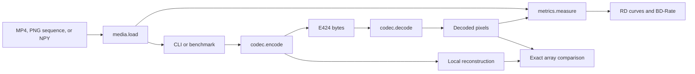
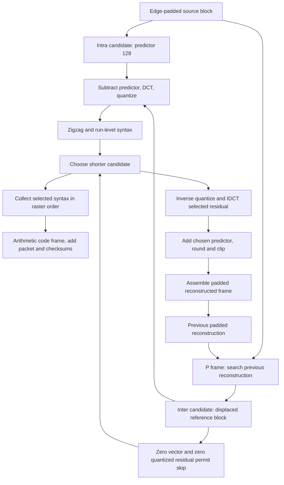
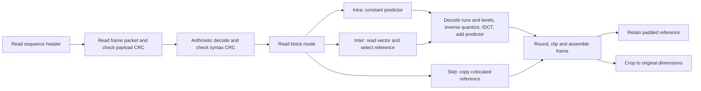

# ENSC 424 hybrid video codec
## Project structure
The project implements the same file format for the intra-only baseline and the hybrid experiment. Holding the transform, quantizer, entropy model and file accounting constant makes the effect of temporal prediction measurable.



| Module | Inputs, outputs and responsibilities |
|---|---|
| en424/__main__.py | Dispatches demo, encode, decode and evaluate. Evaluation runs matched intra/hybrid configurations, times both stages and saves streams, CSV and JSON. |
| en424/media.py | Loads uint8 frames. OpenCV supplies RGB-converted video frames and FPS. PNG files are sorted by filename. NPY preserves array samples. The decoder output can be saved as PNGs or NPY. |
| en424/codec.py | Config validates settings. encode returns bytes, reconstructed pixels and frame statistics. decode takes the complete byte stream and returns pixels and stream metadata. |
| en424/motion.py | estimate selects an integer displacement on luma. compensate copies the selected region of the previous reconstructed frame for all channels. |
| en424/transform.py | Owns the DCT basis, quantization, inverse reconstruction, zigzag order and variable-length integer syntax. |
| en424/entropy.py | Compresses and decompresses the serialized block syntax for one frame at a time. |
| en424/metrics.py | Measures distortion against the source and rate against the complete file. Integrates log-rate differences over shared PSNR. |
| experiments/benchmark.py | Runs the multi-video experiment, compares decoded pixels with encoder reconstruction, and produces measurements, plots and evaluation tables. |

## Encoder and feedback path


An I frame occurs at index zero and every GOP interval. Intra-only makes every frame an I frame. Blocks use 8, 16 or 32 pixels per side. Edge padding preserves the last partial row and column. Each plane uses 8×8 transforms regardless of prediction block size. Color retains three full-resolution planes with shared motion vectors.

For each P block, exhaustive search minimizes the sum of absolute luma differences within the search radius and the padded frame. Ties favor the smallest Manhattan displacement, then the smallest dy and dx. A positive dx reads farther right in the reference. The residual is source minus prediction. For transform matrix C, the encoder computes C·residual·Cᵀ, divides by qstep and rounds to the nearest integer. The inverse multiplies by qstep and applies Cᵀ·coefficients·C. Quantization discards precision. Zigzag ordering collects low frequencies early, and each nonzero coefficient records a preceding zero count and signed level.

The encoder compares complete candidate syntax lengths before arithmetic coding. Inter wins a tie. Skip substitutes a one-byte instruction when the displacement and all quantized residual coefficients are zero. Mode selection uses a byte-count proxy, so it can select a different mode than a full distortion-and-rate search. The encoder reconstructs the winning candidate, rounds and clips to [0,255], and keeps the padded result for the next frame. This makes the next predictor reproducible from the transmitted bytes.

## Independent decoding


Each packet resets eight adaptive binary contexts, one per bit position within a syntax byte. Encoder and decoder update counts in the same order and periodically halve them. The lengths in the packet delimit the payload and decoded syntax. The decoder checks allocation limits, checksums, block modes, vector bounds, coefficient positions and trailing data. See [the byte-level specification](../docs/BITSTREAM.md) for field ordering and integer encoding.

## Verification and reproduction
From the FP directory in PowerShell, run:
```powershell
.\.venv\Scripts\python.exe -m unittest discover -s tests -v
.\.venv\Scripts\python.exe -m experiments.benchmark
```
The default benchmark reads the three installed DemoCreator MP4s listed in the script. Supply paths after the command to use other videos with at least 48 readable frames. The benchmark stores outputs beside the script. Each run compares five settings at steps 8, 16, 32 and 64. The intra baseline and default hybrid share GOP 12, block size 16 and radius 4. The alternatives independently disable skip or change radius to 2 or 8. Full-search candidate count for an interior block grows from 25 to 81 to 289 across those radii.

File bitrate equals 8 × file bytes × fps / frame count. PSNR equals 10 log₁₀(255²/MSE), where MSE includes all original, unpadded samples. Higher PSNR means lower squared error. BD-Rate compares the geometric mean rates across the shared quality interval via a cubic fit to log bitrate. Negative values indicate savings against intra. For correctness, the benchmark separately requires equality between every decoded pixel and its encoder-side reconstruction. [Measured results and rate–distortion plots](results/Evaluation.md).

