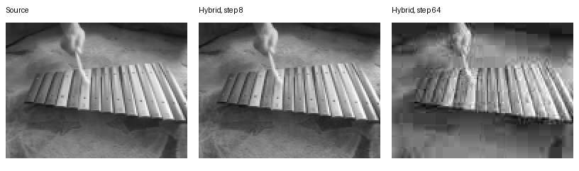

# ENSC 424 final project • A block-based hybrid video codec

## Engineering question
How much bitrate does motion-compensated prediction save over independently coding each frame at comparable quality? The comparison uses a common encoder, decoder, transform, quantizer and arithmetic coder. Only the availability of temporal prediction changes between the two main configurations. The implementation and three block diagrams are in [Architecture](Architecture.md).

## Methods
We evaluated five short excerpts at four quantizer steps (8, 16, 32, 64). For each source the experiment tested intra-only, default hybrid, hybrid with skip disabled, and hybrid with search radii 2 and 8. The default radius is 4. Each 16-frame excerpt includes two I frames. The remaining frames in hybrid mode can choose intra, inter or skip independently for each 16×16 prediction block. Inputs were converted to grayscale, sampled every third source frame and resized to 128 pixels wide. Quality is measured against exactly those preprocessed pixels. Source compression, resizing and grayscale conversion are outside the codec comparison.

The encoder transmits its own E424 bitstream. Total rate includes sequence headers, packet headers, motion vectors, mode decisions and coefficients. PSNR uses one mean squared error over the entire decoded sequence. For each curve, a cubic fit to log bitrate versus PSNR estimates the average percentage rate difference over the shared quality interval. The result depends on curve shape and the interval covered. The plots show the measured points directly.

## Results
| Source | Configuration | BD-Rate vs intra | Mean encode time (s/clip) | Skip blocks across sweep |
|---|---|---:|---:|---:|
| PanZoom.mp4 | hybrid | -68.38% | 1.230 | 776 |
| Template.mp4 | hybrid | -65.04% | 3.156 | 698 |
| textEditing.mp4 | hybrid | -73.88% | 1.060 | 1388 |
| shuttle.avi | hybrid | -49.55% | 1.525 | 324 |
| xylophone.mp4 | hybrid | -46.40% | 3.212 | 210 |

[Application demo measurements and RD plots](results/Evaluation.md) · [Filmed sequence measurements and RD plots](footage/Evaluation.md)

**Skip mode.** On the text-editing excerpt, default hybrid achieved −73.88% BD-Rate against intra, compared with −72.05% with skip disabled. Skip was selected for 1,388 blocks across the four operating points. Skip is cheap to signal when a colocated predictor already reconstructs the block to the quantizer's precision. For moving or newly exposed content the encoder must transmit residuals or choose intra.

**Search radius.** On Template the measured differences against intra were −64.46%, −65.04% and −65.01% at radii 2, 4 and 8. A larger window exposes more predictors, but selection minimizes luma SAD first and then compares syntax lengths. That process need not minimize final arithmetic-coded bytes at fixed PSNR. The measurements support retaining radius 4 as a practical default for this experiment. Timing in the tables is descriptive. Runs shared a workstation and were timed once per operating point.

**Hard scene cut.** A separate 16-frame test switches from shuttle footage to xylophone footage at frame 8 inside a GOP. The previous P packet used 706 bytes and zero intra blocks. The cut used 2,821 bytes and 42 of its 48 blocks switched to intra. The following packet used 878 bytes and only one intra block. This shows the block-level fallback handling a sudden loss of temporal correlation and returning to prediction before the next scheduled I frame. [Per-frame counts](cut.csv)

**Visible distortion.** The figure shows sampled source frame 45 from xylophone at twice its decoded dimensions. At step 64 the smooth floor separates into visible blocks and the edges of the bars lose detail. At step 8 more of the floor texture and bar edges survive.



## Correctness and scope
All 100 streams in the five-source sweep passed exact comparison between the independent decoder and encoder reconstruction. The hard-cut experiment passed the same check. All 13 existing unit tests passed, including entropy round trips, transform inversion, motion-vector direction, RGB/grayscale reconstruction, padding, skip behavior, corrupt packets and metric checks.

These measurements establish end-to-end operation on the tested streams. Short grayscale excerpts and a four-point cubic fit limit generalization. The implementation processes clips in memory, performs exhaustive integer search, and supports full-resolution RGB. The measured rates and times apply to the reduced-resolution workload. The design is documented alongside the [bitstream specification](../docs/BITSTREAM.md).

## Reproduction
Run from the project root using its Python virtual environment. The default experiment reads the three installed DemoCreator videos. The second command set uses the local MATLAB sample files.
```powershell
.\.venv\Scripts\python.exe -m experiments.benchmark
$env:EN424_RESULTS = 'footage'
$m = 'C:\Program Files\MATLAB\R2025b\toolbox\matlab'
.\.venv\Scripts\python.exe -m experiments.benchmark "$m/demos/shuttle.avi" "$m/audiovideo/xylophone.mp4"
Remove-Item Env:EN424_RESULTS
.\.venv\Scripts\python.exe -m experiments.scene_cut
.\.venv\Scripts\python.exe -m experiments.detail
.\.venv\Scripts\python.exe -m unittest discover -s tests -v
```

## Design references
The [project proposal](../references/ENSC%20424%20Project%20Proposal.pdf) defines the baseline and evaluation objectives. Course lectures on transforms, quantization and arithmetic coding inform the spatial pipeline. The Motion and H.264/HEVC lectures describe block matching and closed-loop prediction. The proposal lists Wiegand et al. and Sullivan et al. for hybrid codec architecture and Barman et al. for interpreting BD-Rate. The measured results here are from this project's own executable.


## Instructor iteration-0 comparison

The updated luminance codec encoded Foreman frames 0–99 at 176 × 144, with one I-frame and 99 P-frames. All five saved streams passed exact decoder agreement. Complete-stream bpp counts every byte required for decoding. Whole-sequence luma PSNR assumes pooled MSE. The instructor did not specify PSNR aggregation.

| Quality setting | Instructor bpp | Instructor PSNR (dB) | Project bpp | Project PSNR (dB) |
|---:|---:|---:|---:|---:|
| 10 | 0.38 | 29.12 | 0.145 | 29.98 |
| 30 | 0.61 | 31.27 | 0.252 | 31.92 |
| 50 | 0.80 | 32.64 | 0.389 | 33.77 |
| 70 | 1.07 | 34.10 | 0.550 | 35.55 |
| 90 | 1.93 | 38.78 | 1.096 | 40.21 |

Project quality settings select uniform quantizer steps 65, 42, 29, 21 and 10. Comparing curves over the shared 29.98–38.78 dB interval gives −60.89% BD-Rate relative to iteration 0. These measurements apply to this development sequence. [Exact measurements](instructor_foreman/measured.csv) · [Reference and comparison](instructor_foreman/comparison.json) · [Reproduction and updated architecture](../docs/LUMINANCE.md)
