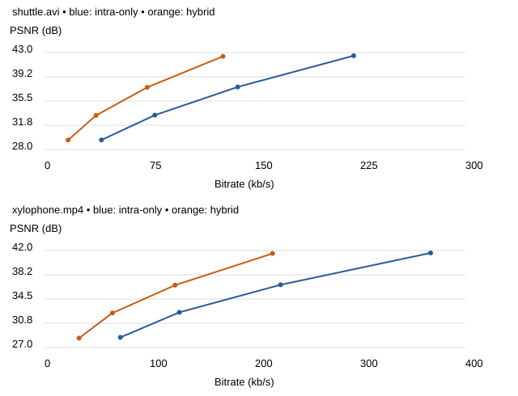

# Codec evaluation

Source videos are decoded by OpenCV. Each trial uses source frames 0, 3, …, 45, converted to grayscale and area-resized to 128 pixels wide. The playback rate is one third of the original. All modes see identical pixels. Each sequence spans two GOPs (I frames at indices 0 and 12).

| Clip | Configuration | BD-Rate vs intra | Mean encode time (s/clip) | Skip blocks across sweep |
|---|---|---:|---:|---:|
| shuttle.avi | intra | 0.00% | 2.089 | 0 |
| shuttle.avi | hybrid | -49.55% | 1.525 | 324 |
| shuttle.avi | no_skip | -48.92% | 1.981 | 0 |
| shuttle.avi | radius2 | -49.50% | 3.154 | 314 |
| shuttle.avi | radius8 | -49.42% | 4.107 | 325 |
| xylophone.mp4 | intra | 0.00% | 3.646 | 0 |
| xylophone.mp4 | hybrid | -46.40% | 3.212 | 210 |
| xylophone.mp4 | no_skip | -46.14% | 3.332 | 0 |
| xylophone.mp4 | radius2 | -46.55% | 2.814 | 217 |
| xylophone.mp4 | radius8 | -46.39% | 3.167 | 216 |

All 40 independently decoded streams matched the encoder reconstruction pixel for pixel. Timing is one encode per operating point and excludes preprocessing and decode. BD-Rate integrates a cubic fit over overlapping PSNR only. Short, downscaled grayscale excerpts limit extrapolation to full-resolution color footage.

