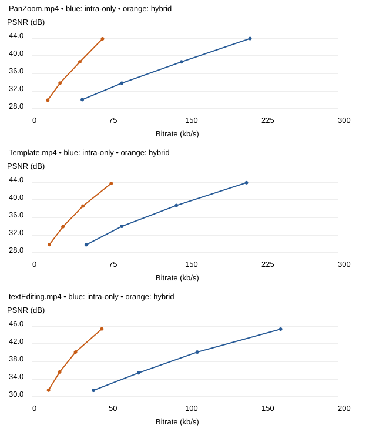

# Codec evaluation

Source videos are decoded by OpenCV. Each trial uses source frames 0, 3, …, 45, converted to grayscale and area-resized to 128 pixels wide. The playback rate is one third of the original. All modes see identical pixels. Each sequence spans two GOPs (I frames at indices 0 and 12).

| Clip | Configuration | BD-Rate vs intra | Mean encode time (s/clip) | Skip blocks across sweep |
|---|---|---:|---:|---:|
| PanZoom.mp4 | intra | 0.00% | 1.252 | 0 |
| PanZoom.mp4 | hybrid | -68.38% | 1.230 | 776 |
| PanZoom.mp4 | no_skip | -67.58% | 1.141 | 0 |
| PanZoom.mp4 | radius2 | -68.54% | 1.044 | 743 |
| PanZoom.mp4 | radius8 | -68.59% | 1.596 | 779 |
| Template.mp4 | intra | 0.00% | 1.831 | 0 |
| Template.mp4 | hybrid | -65.04% | 3.156 | 698 |
| Template.mp4 | no_skip | -64.20% | 3.748 | 0 |
| Template.mp4 | radius2 | -64.46% | 1.625 | 633 |
| Template.mp4 | radius8 | -65.01% | 2.792 | 696 |
| textEditing.mp4 | intra | 0.00% | 1.499 | 0 |
| textEditing.mp4 | hybrid | -73.88% | 1.060 | 1388 |
| textEditing.mp4 | no_skip | -72.05% | 1.670 | 0 |
| textEditing.mp4 | radius2 | -73.77% | 1.448 | 1425 |
| textEditing.mp4 | radius8 | -73.77% | 4.420 | 1379 |

All 60 independently decoded streams matched the encoder reconstruction pixel for pixel. Timing is one encode per operating point and excludes preprocessing and decode. BD-Rate integrates a cubic fit over overlapping PSNR only. Short, downscaled grayscale excerpts limit extrapolation to full-resolution color footage.

